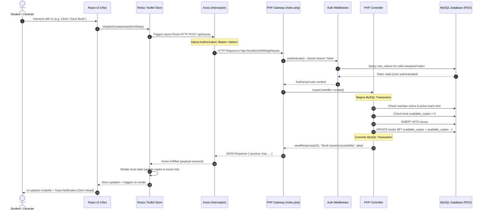
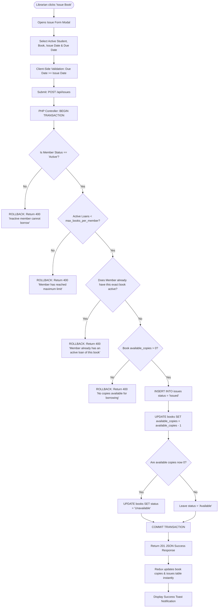
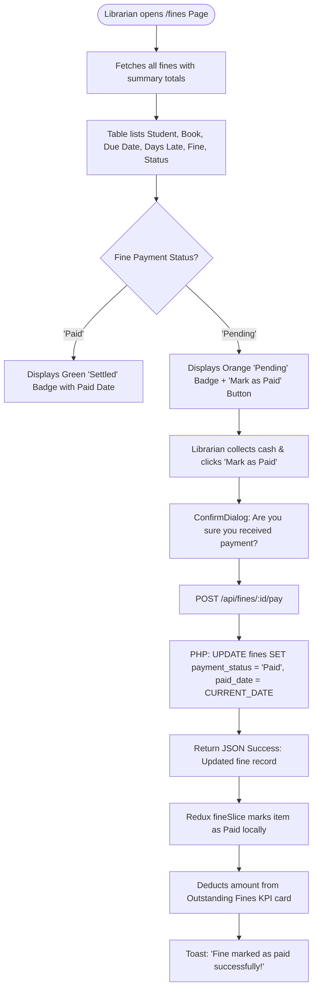

# Library Management System — College Project Presentation & System Workflows

---

# SECTION 1: POWERPOINT (PPT) SLIDE DECK

---

## Slide 1: Title Slide
* **Header / Title:** Library Management System (LMS)
* **Subtitle:** Modern Full-Stack College Web Application
* **Presenter:** [Your Name / Team Members / Roll Numbers]
* **Department:** Department of Computer Science & Engineering / Information Technology
* **College:** [Your College / University Name]
* **Guide / Supervisor:** [Project Guide's Name]
* **Core Stack:** React.js (Vite) • Redux Toolkit • Tailwind CSS • PHP REST API • MySQL

---

## Slide 2: Problem Statement & Motivation
* **Manual Record Keeping:** Traditional register-based libraries suffer from lost records, duplicate entries, and illegible hand-written notes.
* **Inventory Miscalculations:** Inaccurate physical book counts lead to discrepancies in available copies versus borrowed copies.
* **Manual Fine Calculation:** Librarians spend excessive time manually counting overdue days and computing late fees.
* **Lack of Visibility:** Students and staff lack real-time visibility into book availability, overdue status, and borrowing limits.
* **Project Motivation:** Build a clean, responsive, fast, and automated web-based solution ensuring complete transactional data consistency.

---

## Slide 3: Project Objectives
* **Catalog Automation:** Provide complete CRUD management for books, authors, and classification categories.
* **Real-Time Inventory Tracking:** Automatically maintain physical stock by decrementing available copies upon issue and restoring upon return.
* **Transactional Reliability:** Guarantee database consistency using MySQL transactions (`BEGIN`, `COMMIT`, `ROLLBACK`) for circulation actions.
* **Automated Penalty Assessment:** Compute late return fines on the server at ₹5/day with payment ledger tracking.
* **Zero Page-Reload User Experience:** Centralize application state with Redux Toolkit so tables and metrics update instantly without browser refreshing.

---

## Slide 4: Technology Stack
* **Frontend:**
  * **React.js 18 + Vite 5:** Fast modular UI rendering with component reusability.
  * **Redux Toolkit (`@reduxjs/toolkit`):** Predictable global state management using slices and `createAsyncThunk`.
  * **Tailwind CSS v3:** Clean utility-first styling with responsive grid layouts.
  * **Axios:** HTTP client equipped with request/response interceptors for Bearer Token injection.
  * **React Hot Toast & React Icons:** Clean toast notifications and Feather icons.
* **Backend:**
  * **Pure PHP 8.x REST API:** Lightweight, native RESTful routing without heavy framework overhead.
  * **PHP PDO (PHP Data Objects):** Secure database communications with prepared statements.
  * **Bcrypt & Session Tokens:** `password_hash()` encryption and database-backed Bearer tokens.
* **Database:**
  * **MySQL / MariaDB:** Relational schema with foreign keys, unique constraints, and transaction support.

---

## Slide 5: System Architecture (3-Tier Model)
* **Tier 1: Presentation Layer (React + Vite)**
  * Responsive client-side routing (`React Router DOM`).
  * 17 reusable UI components (Buttons, Modals, Tables with Skeletons, Stat Cards).
  * Redux store maintaining local copies of books, members, issues, and statistics.
* **Tier 2: Application / API Layer (PHP REST API)**
  * Centralized API Gateway (`index.php`) and URI Router (`routes/api.php`).
  * Authentication middleware inspecting Bearer tokens.
  * Business logic controllers executing circulation rules and calculations.
* **Tier 3: Persistence Layer (MySQL)**
  * Relational database with foreign key constraints (`ON DELETE RESTRICT`).
  * Transaction isolation preventing race conditions during simultaneous book loans.

---

## Slide 6: Key Functional Modules
* **1. Authentication & Security:** Secure login, librarian registration, role management, and session revocation.
* **2. Live Dashboard:** 8 real-time KPI metrics, recent borrow activity, popular books, and overdue attention lists.
* **3. Books Management:** Book cataloging with ISBN validation, publisher, shelf rack numbers, and stock tracking.
* **4. Member / Student Directory:** Student registration with academic branch, degree, phone, and active loan checks.
* **5. Authors & Categories:** Subject categorization and author profiling with book count indicators.
* **6. Circulation Engine:** Issue book verification (active student status, loan limits, duplicate loan prevention).
* **7. Check-In & Returns:** Automatic overdue days calculation, fine estimation, and inventory increment.
* **8. Fine Management:** Outstanding fines ledger, payment recording, and financial summary cards.
* **9. Settings:** Configurable fine rates, loan terms (days), and maximum book allowance.

---

## Slide 7: Working Mechanism — Redux & API Synchronization
* **Client Action:** User triggers an action (e.g., clicks *"Issue Book"*).
* **Thunk Dispatch:** React calls `dispatch(createIssue(formData))`.
* **API Interceptor:** Axios automatically attaches `Authorization: Bearer <token>` from `localStorage`.
* **Server Verification:** PHP middleware checks token validity against the `user_tokens` table.
* **Controller Execution:** Controller starts a MySQL transaction, executes business validation, and modifies records.
* **State Mutation:** Redux reducer receives the payload in `extraReducers (fulfilled)` and updates local store.
* **UI Re-render:** Table and dashboard components update immediately with toast notifications — **Zero page reload**.

---

## Slide 8: Database Schema & Relational Integrity
* **Entities:** `users`, `user_tokens`, `categories`, `authors`, `books`, `members`, `issues`, `fines`, `settings`.
* **Foreign Key Constraints:**
  * `books.author_id ➔ authors.id` (`ON DELETE RESTRICT`)
  * `books.category_id ➔ categories.id` (`ON DELETE RESTRICT`)
  * `issues.member_id ➔ members.id` (`ON DELETE RESTRICT`)
  * `issues.book_id ➔ books.id` (`ON DELETE RESTRICT`)
  * `fines.issue_id ➔ issues.id` (`ON DELETE RESTRICT`)
* **Integrity Guard:** The system prohibits deleting authors, categories, books, or members that have active links or unreturned loans.

---

## Slide 9: ACID Transactions in Circulation
* **Why Transactions Matter:** In circulation, updating a loan record while failing to decrement physical book copies results in corrupted inventory.
* **Issue Transaction Lifecycle:**
  1. `BEGIN TRANSACTION`
  2. Verify member is `Active` and has not exceeded loan allowance (`max_books_per_member`).
  3. Verify member does not already possess an active loan of the same book.
  4. Verify book has `available_copies > 0`.
  5. `INSERT INTO issues (...)`
  6. `UPDATE books SET available_copies = available_copies - 1`
  7. `COMMIT` (or `ROLLBACK` on any error)
* **Return Transaction Lifecycle:**
  1. `BEGIN TRANSACTION`
  2. Verify issue exists and status is not already `Returned`.
  3. Calculate overdue days = $\max(0, \text{Return Date} - \text{Due Date})$.
  4. Compute fine: $\text{Overdue Days} \times \text{Fine Rate (₹5.00)}$.
  5. `UPDATE issues SET status = 'Returned', return_date = :date`
  6. `UPDATE books SET available_copies = available_copies + 1`
  7. If fine $> 0$, create/update record in `fines`.
  8. `COMMIT`

---

## Slide 10: Automatic Overdue Fine Calculation Engine
* **Formula:**
  $$\text{Overdue Days} = \max(0, \text{Return Date} - \text{Due Date})$$
  $$\text{Fine Amount} = \text{Overdue Days} \times \text{Fine Per Day (₹5.00)}$$
* **Example Scenario:**
  * Due Date: 15 September
  * Return Date: 19 September
  * Days Overdue: 4 Days
  * Fine Assessed: $4 \times ₹5.00 = ₹20.00$
* **Payment Settlement:**
  * Fines default to status `Pending`.
  * The librarian collects the cash at the counter and clicks *"Mark as Paid"*.
  * Fine status updates to `Paid` with timestamp; dashboard financial KPI adjusts in real time.

---

## Slide 11: Security & Validation Implementations
* **Password Encryption:** Bcrypt hashing using PHP `password_hash($pass, PASSWORD_BCRYPT)` with salt.
* **SQL Injection Defense:** 100% prepared statements via PDO (`$stmt->bindValue()`) with emulated prepares disabled.
* **Session Management:** Secure 64-character hexadecimal Bearer tokens stored with expiration dates.
* **CORS Security:** Explicit headers configured in `response.php` for origin, methods, and authorization headers.
* **Dual-Layer Validation:**
  * Client: Immediate field feedback (ISBN length, regex email format, positive integers).
  * Server: Sanitization via `htmlspecialchars()` and relational validation in controllers.

---

## Slide 12: Engineering Challenges Faced
* **1. Relational Race Conditions:** Preventing two librarians from issuing the last copy of the same book simultaneously.
* **2. MySQL Port Variance:** Handling environments running on standard port `3306` vs. secondary port `3307` (e.g., dual MySQL & MariaDB installations).
* **3. Maintaining UI State Without Page Reloads:** Ensuring Redux store reflects book inventory and loan statuses immediately after action completion.
* **4. Responsive Table Layouts:** Preventing wide multi-column tables from breaking mobile screens.

---

## Slide 13: Technical Solutions Implemented
* **Pessimistic Locking & Transactions:** Implemented `SELECT ... FOR UPDATE` inside transactions to serialize inventory modifications.
* **Database Connection Auto-Fallback:** Configured PDO in `database.php` to attempt port 3306 first, and seamlessly try port 3307 if refused.
* **Optimistic Local Reducer Mutation:** Reducers locally adjust copies and remove/modify records upon fulfilled async thunks.
* **Horizontal Scroll Wrappers:** Wrapped all tabular components with overflow-x containers and responsive badges.

---

## Slide 14: Future Scope & Enhancements
* **Barcode & QR Code Scanner:** Support USB / camera barcode scanners for rapid book issue and return scanning.
* **Student Self-Service Portal:** Student login to check borrow history, search books, and reserve copies online.
* **Automated Email / SMS Notifications:** Integration with Twilio/PHPMailer for automated return reminder notices 2 days before due date.
* **Online Fine Payment:** Payment gateway integration (Razorpay / UPI / Stripe) for direct fine settlements.
* **RFID Gate Integration:** Automated anti-theft and attendance tracking via RFID sensors.

---

## Slide 15: Conclusion & Learning Outcomes
* Successfully designed and implemented a production-grade **full-stack Library Management System**.
* Gained hands-on experience in **React component design**, **Redux Toolkit state management**, and **Tailwind CSS**.
* Mastered backend **REST API design with pure PHP**, **PDO prepared statements**, and **MySQL ACID transactions**.
* Built a complete, responsive solution ready for real-world college library deployments and academic viva defense.

---

## Slide 16: Question & Answer (Q&A)
* **Thank You!**
* Open for questions and live system demonstration.

---
---

# SECTION 2: SYSTEM WORKFLOWS

---

## 1. High-Level Architectural Workflow



---

## 2. Authentication & Session Lifecycle Workflow

```mermaid
flowchart TD
    Start([User visits App]) --> CheckAuth{Token in LocalStorage?}
    CheckAuth -- No --> RedirectLogin[Redirect to /login]
    CheckAuth -- Yes --> VerifySession[Axios GET /api/me with Bearer Token]
    VerifySession --> TokenValid{Token Valid in DB?}
    TokenValid -- Yes --> Dashboard[Allow access to Protected Routes /dashboard]
    TokenValid -- No --> ClearStorage[Clear Token from localStorage] --> RedirectLogin

    RedirectLogin --> EnterCreds[User enters Email & Password]
    EnterCreds --> PostLogin[POST /api/login]
    PostLogin --> FindUser[PHP: Query user by email]
    FindUser --> UserExists{User exists?}
    UserExists -- No --> LoginFail[Return 401: Invalid Credentials] --> ShowError[Toast: Invalid Login]
    UserExists -- Yes --> VerifyHash[PHP: password_verify(password, hash)]
    VerifyHash --> PasswordCorrect{Password matches?}
    PasswordCorrect -- No --> LoginFail
    PasswordCorrect -- Yes --> GenToken[Generate 64-char Hex Token]
    GenToken --> SaveToken[INSERT INTO user_tokens with 30-day expiry]
    SaveToken --> ReturnToken[Return JSON: user info + token]
    ReturnToken --> StoreLocal[Redux saves user & sets localStorage token]
    StoreLocal --> RedirectDash[Navigate to /dashboard with Success Toast]
```

---

## 3. Book Issue (Circulation) Workflow with ACID Transaction



---

## 4. Book Return & Automated Fine Assessment Workflow

```mermaid
flowchart TD
    Start([Librarian clicks 'Check In / Return']) --> Modal[Open Return Modal]
    Modal --> PickDate[Select or Confirm Return Date]
    PickDate --> LivePreview[Frontend calculates preview: Overdue Days * ₹5.00]
    LivePreview --> Submit[Click 'Confirm Return' -> POST /api/issues/:id/return]
    
    Submit --> BeginTx[PHP: BEGIN TRANSACTION]
    BeginTx --> CheckIssue{Issue exists & status != 'Returned'?}
    CheckIssue -- No --> ErrAlready[ROLLBACK: Return 400 'Already returned']
    CheckIssue -- Yes --> CalcDelta[Calculate Overdue Days: max(0, Return Date - Due Date)]
    
    CalcDelta --> FetchRate[Fetch fine_per_day from settings table default ₹5]
    FetchRate --> CalcFine[fine_amount = overdue_days * fine_rate]
    
    CalcFine --> UpdateIssue[UPDATE issues SET status = 'Returned', return_date = :date]
    UpdateIssue --> RestoreCopies[UPDATE books SET available_copies = available_copies + 1, status = 'Available']
    
    RestoreCopies --> HasFine{Is fine_amount > 0?}
    HasFine -- Yes --> CreateFine[INSERT INTO fines issue_id, member_id, overdue_days, fine_amount, payment_status='Pending']
    HasFine -- No --> Commit[COMMIT TRANSACTION]
    CreateFine --> Commit
    
    Commit --> ReturnResponse[Return JSON response with fine details & updated copies]
    ReturnResponse --> ReduxUpdate[Redux updates issues list & restores book copy]
    ReduxUpdate --> ToastNotice[Toast: Book returned + Fine summary]
```

---

## 5. Fine Settlement Workflow



---

## 6. Relational Integrity & Data Loss Prevention Workflow

```mermaid
flowchart TD
    Action([Librarian clicks Delete on Author / Category / Book / Member]) --> Prompt[Confirm Dialog Modal appears]
    Prompt --> Confirm[User confirms deletion]
    Confirm --> Request[DELETE /api/{resource}/{id}]
    Request --> Controller[PHP Resource Controller]
    
    Controller --> ResourceType{What is being deleted?}
    
    ResourceType -- Category --> CheckCatBooks{Any books reference this category_id?}
    CheckCatBooks -- Yes --> BlockCat[Return 409 Conflict: Cannot delete category with linked books]
    CheckCatBooks -- No --> DeleteCat[DELETE FROM categories WHERE id = :id]
    
    ResourceType -- Author --> CheckAuthBooks{Any books reference this author_id?}
    CheckAuthBooks -- Yes --> BlockAuth[Return 409 Conflict: Cannot delete author with cataloged books]
    CheckAuthBooks -- No --> DeleteAuth[DELETE FROM authors WHERE id = :id]
    
    ResourceType -- Book --> CheckBookLoans{Any active issues with status 'Issued' or 'Overdue'?}
    CheckBookLoans -- Yes --> BlockBook[Return 409 Conflict: Cannot delete book currently loaned to students]
    CheckBookLoans -- No --> DeleteBook[DELETE FROM books WHERE id = :id]
    
    ResourceType -- Member --> CheckMemberLoans{Any unreturned books for this member?}
    CheckMemberLoans -- Yes --> BlockMember[Return 409 Conflict: Cannot delete student with active book loans]
    CheckMemberLoans -- No --> DeleteMember[DELETE FROM members WHERE id = :id]
```
