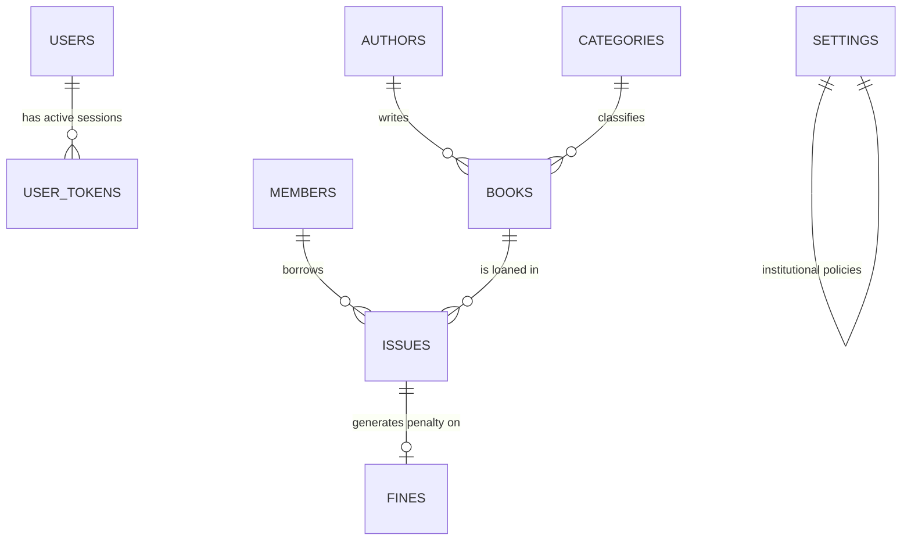

# Library Management System — College Assignment

A complete, responsive, full-stack **Library Management System** built with **React.js (Vite)**, **Redux Toolkit**, **Tailwind CSS**, and a **pure PHP REST API** backed by **MySQL**.

Designed with clean architecture, enterprise state management, transactional database operations, and rich realistic seed data for college assignment demonstration and viva defense.

---

## 📌 Table of Contents

1. [Project Overview](#project-overview)
2. [Key Features](#key-features)
3. [Technology Stack](#technology-stack)
4. [System Architecture & Folder Structure](#system-architecture--folder-structure)
5. [Prerequisites & System Requirements](#prerequisites--system-requirements)
6. [Database Setup & Seed Data](#database-setup--seed-data)
7. [Backend Setup (PHP REST API)](#backend-setup-php-rest-api)
8. [Frontend Setup (React + Vite)](#frontend-setup-react--vite)
9. [Default Credentials & Password Management](#default-credentials--password-management)
10. [REST API Documentation](#rest-api-documentation)
11. [Redux Toolkit State Architecture](#redux-toolkit-state-architecture)
12. [Database Schema & ER Relationships](#database-schema--er-relationships)
13. [Business Logic & MySQL Transactions](#business-logic--mysql-transactions)
14. [Step-by-Step Testing & Viva Demonstration Checklist](#step-by-step-testing--viva-demonstration-checklist)
15. [Troubleshooting & Common Issues](#troubleshooting--common-issues)
16. [Screenshots](#screenshots)

---

## 1. Project Overview

The **Library Management System** enables college librarians and academic administrators to automate book circulation, student registrations, cataloging, lending periods, penalty calculations, and institutional rules.

### Core Modules:
* **Authentication:** Secure bcrypt password hashing, token-based session verification, protected routes.
* **Dashboard:** 8 real-time live statistics cards, recent circulation logs, popular books by loan frequency, overdue books with calculated penalty fines.
* **Books Management:** Complete CRUD, search by title/ISBN/author, category and author filters, pagination, inventory copies tracking, active loan deletion protection.
* **Student / Member Management:** Complete student directory, department, course, academic year, contact details, active borrowings count, fine balance, active loan deletion protection.
* **Author & Category Catalogs:** Categorization of volumes and academic authors with relational integrity guards.
* **Issue Book Circulation:** Strict validation (member active status, loan limits, available copy checks, duplicate active issue prevention, transactional copies deduction).
* **Return Book & Fine Engine:** Transactional check-in, automated calculation of overdue days and fines at ₹5/day, inventory restoration, fine creation.
* **Fine Management:** Fine tracking by student, payment collection recording, and outstanding totals summary.
* **System Settings:** Configurable fine rate, maximum loan days, maximum active books per student, and library desk contacts.

---

## 2. Key Features

* **Zero Page-Reload CRUD:** All create, update, delete, issue, return, and payment actions update Redux state immediately.
* **Transactional Reliability:** MySQL `BEGIN TRANSACTION ... COMMIT / ROLLBACK` for issue and return operations to prevent inconsistent state.
* **Comprehensive Validation:** Dual-layer client-side validation + server-side validation with standard HTTP error codes (`400`, `401`, `404`, `409`, `422`, `500`).
* **Rich Realistic Seed Data:** 21 curated academic textbooks, 10 prominent authors, 8 academic categories, 10 enrolled students across engineering and computer science, and active/overdue borrow records.
* **Responsive UI:** Full desktop layout (Sidebar + Navbar) and mobile layout (collapsible drawer + navbar) with Tailwind CSS.

---

## 3. Technology Stack

| Layer | Technologies Used |
| :--- | :--- |
| **Frontend** | React 18, Vite 5, React Router DOM v6 |
| **State Management** | Redux Toolkit (`@reduxjs/toolkit`, `react-redux`) |
| **Styling** | Tailwind CSS v3, PostCSS, Autoprefixer |
| **Icons & Notifications**| React Icons (`react-icons/fi`), React Hot Toast |
| **HTTP Client** | Axios with interceptors for Bearer Token |
| **Backend** | Plain PHP 8.x REST API (Zero framework dependency) |
| **Database** | MySQL / MariaDB via PHP PDO (Prepared Statements) |
| **Authentication** | Bearer Token Session Management + PHP `password_hash()` |

---

## 4. System Architecture & Folder Structure

```text
library-management-system/
│
├── frontend/
│   ├── src/
│   │   ├── app/
│   │   │   └── store.js                   # Redux Toolkit store combining all 7 slices
│   │   ├── api/
│   │   │   └── axios.js                   # Configured Axios instance with Bearer token interceptor
│   │   ├── components/
│   │   │   ├── common/                    # 17 Reusable UI components
│   │   │   │   ├── Button.jsx             # Primary, secondary, danger, outline, loading states
│   │   │   │   ├── Input.jsx              # Standard text/email/number input with validation
│   │   │   │   ├── DateInput.jsx          # Calendar date picker input
│   │   │   │   ├── Select.jsx             # Accessible dropdown with custom styling
│   │   │   │   ├── FormField.jsx          # Label & error wrapper
│   │   │   │   ├── Modal.jsx              # Accessible modal dialog with backdrop
│   │   │   │   ├── ConfirmDialog.jsx      # Confirmation modal for delete/payments
│   │   │   │   ├── Table.jsx              # Reusable table with sorting, pagination, skeletons
│   │   │   │   ├── Pagination.jsx         # Page navigation controls
│   │   │   │   ├── SearchInput.jsx        # Search box with clear button
│   │   │   │   ├── StatusBadge.jsx        # Badges (Available, Issued, Overdue, Returned, Paid)
│   │   │   │   ├── LoadingSpinner.jsx     # SVG animated spinner
│   │   │   │   ├── Skeleton.jsx           # Animated placeholder skeletons
│   │   │   │   ├── EmptyState.jsx         # Friendly empty state display
│   │   │   │   ├── ErrorState.jsx         # Error alert card with retry action
│   │   │   │   ├── PageHeader.jsx         # Standard title, subtitle, and action buttons
│   │   │   │   ├── Card.jsx               # Container card
│   │   │   │   └── StatCard.jsx           # Metric KPI card
│   │   │   ├── layout/
│   │   │   │   ├── Navbar.jsx             # Top bar with current user badge and logout
│   │   │   │   ├── Sidebar.jsx            # Responsive sidebar navigation with icons
│   │   │   │   └── MainLayout.jsx         # App shell wrapper
│   │   │   ├── books/
│   │   │   │   ├── BookForm.jsx           # Form for adding/editing books
│   │   │   │   └── BookDetailsModal.jsx   # Detailed preview of book metadata
│   │   │   ├── members/
│   │   │   │   ├── MemberForm.jsx         # Form for student profile management
│   │   │   │   └── MemberDetailsModal.jsx # Detailed student borrow profile
│   │   │   └── issues/
│   │   │       ├── IssueFormModal.jsx     # Modal for issuing books to students
│   │   │       └── ReturnModal.jsx        # Check-in modal with live fine calculation
│   │   ├── pages/
│   │   │   ├── auth/
│   │   │   │   ├── Login.jsx              # Sign-in page with 1-click demo filler
│   │   │   │   └── Register.jsx           # New librarian/staff registration
│   │   │   ├── dashboard/
│   │   │   │   └── Dashboard.jsx          # Live statistics, tables, overdue loans
│   │   │   ├── books/
│   │   │   │   ├── BookList.jsx           # Books catalog table with filters
│   │   │   │   ├── BookCreate.jsx         # New book catalog page
│   │   │   │   ├── BookDetail.jsx         # Book details view page
│   │   │   │   └── BookEdit.jsx           # Edit book page
│   │   │   ├── members/
│   │   │   │   ├── MemberList.jsx         # Student members directory
│   │   │   │   ├── MemberCreate.jsx       # Student registration page
│   │   │   │   ├── MemberDetail.jsx       # Student profile view page
│   │   │   │   └── MemberEdit.jsx         # Edit student page
│   │   │   ├── categories/
│   │   │   │   └── CategoryList.jsx       # Category management with book counts
│   │   │   ├── authors/
│   │   │   │   └── AuthorList.jsx         # Author directory with book counts
│   │   │   ├── issues/
│   │   │   │   ├── IssueList.jsx          # Circulation registry table
│   │   │   │   └── IssueCreate.jsx        # Dedicated book issue page
│   │   │   ├── returns/
│   │   │   │   └── ReturnList.jsx         # Check-in return page with fine assessment
│   │   │   ├── fines/
│   │   │   │   └── FineList.jsx           # Fine ledger and payment settlements
│   │   │   └── settings/
│   │   │       └── Settings.jsx           # Institutional policies and fine fee settings
│   │   ├── features/
│   │   │   ├── auth/authSlice.js          # Authentication async thunks & state
│   │   │   ├── books/bookSlice.js         # Books CRUD async thunks & state
│   │   │   ├── members/memberSlice.js     # Members CRUD async thunks & state
│   │   │   ├── categories/categorySlice.js# Category async thunks & state
│   │   │   ├── authors/authorSlice.js     # Author async thunks & state
│   │   │   ├── issues/issueSlice.js       # Issues, returns, and fines async thunks
│   │   │   └── dashboard/dashboardSlice.js# Dashboard statistics async thunk
│   │   ├── routes/
│   │   │   └── AppRoutes.jsx              # Protected route wrappers and navigation
│   │   ├── utils/
│   │   │   ├── constants.js               # Status badges, colors, and API defaults
│   │   │   ├── helpers.js                 # Currency format, date format, error parser
│   │   │   └── validation.js              # Client-side form validators
│   │   ├── App.jsx                        # Root React component with Hot Toast
│   │   ├── main.jsx                       # Entry file with Redux Provider
│   │   └── index.css                      # Tailwind base & custom scrollbars
│   ├── package.json
│   ├── vite.config.js
│   ├── tailwind.config.js
│   ├── postcss.config.js
│   ├── index.html
│   └── .env
│
├── backend/
│   ├── config/
│   │   └── database.php                   # PDO Singleton with port auto-fallback (3306/3307)
│   ├── middleware/
│   │   └── auth.php                       # Bearer Token inspection and session validator
│   ├── controllers/
│   │   ├── AuthController.php             # Login, register, logout, me
│   │   ├── BookController.php             # Books CRUD, inventory validation, relations
│   │   ├── MemberController.php           # Student CRUD, active loans check
│   │   ├── CategoryController.php         # Categories CRUD and book constraints
│   │   ├── AuthorController.php           # Authors CRUD and book constraints
│   │   ├── IssueController.php            # Transactional issue logic and lending limits
│   │   ├── ReturnController.php           # Transactional return logic and fine computation
│   │   ├── FineController.php             # Fines audit and payment settlement
│   │   ├── SettingController.php          # Library settings configuration
│   │   └── DashboardController.php        # Dynamic SQL counts and overdue queries
│   ├── routes/
│   │   └── api.php                        # REST router mapping URL patterns to controllers
│   ├── utils/
│   │   ├── response.php                   # JSON formatting and CORS headers
│   │   └── validation.php                 # Sanitization, input parser, email validator
│   ├── .htaccess                          # Apache URL rewrite configuration
│   └── index.php                          # API gateway entry point
│
├── database/
│   └── library_management.sql             # Complete MySQL schema + realistic sample data
│
├── start-all.bat                          # One-click Windows runner for backend + frontend
├── start-backend.bat                      # Starts PHP REST API server on port 8000
├── start-frontend.bat                     # Starts React Vite dev server on port 5173
└── README.md                              # Complete assignment documentation
```

---

## 5. Prerequisites & System Requirements

To run this application locally, you need:

1. **Node.js**: v18.0.0 or higher ([Download Node.js](https://nodejs.org/))
2. **PHP**: v8.0 or higher ([PHP Official Site](https://www.php.net/) or bundled with XAMPP/WAMP/Laragon)
   - Ensure `pdo_mysql` extension is enabled in `php.ini` (enabled by default in XAMPP).
3. **MySQL / MariaDB**: MySQL 5.7+, MySQL 8.0+, or MariaDB 10.3+

---

## 6. Database Setup & Seed Data

1. Start your MySQL / MariaDB server (e.g. through the **XAMPP Control Panel** or standard Windows Service).
2. Open **phpMyAdmin** (`http://localhost/phpmyadmin`) or your MySQL CLI client:
   ```bash
   mysql -u root -p
   ```
3. Create the database:
   ```sql
   CREATE DATABASE IF NOT EXISTS library_management;
   ```
4. Import the SQL file `database/library_management.sql`:
   * **In phpMyAdmin:** Select `library_management` database -> click **Import** tab -> choose `database/library_management.sql` -> click **Import**.
   * **Via Command Line:**
     ```bash
     mysql -u root -p library_management < database/library_management.sql
     ```

The database comes pre-seeded with:
* **1 Admin User:** `admin@library.com` (password: `admin123`)
* **8 Academic Categories:** Programming, Computer Science, Database Systems, Networking, Mathematics, Science, Literature, History.
* **10 Prominent Authors:** Robert C. Martin, Martin Fowler, Andrew S. Tanenbaum, Donald Knuth, Thomas H. Cormen, etc.
* **21 Textbooks:** Complete with ISBNs, publication years, shelf locations, and copies.
* **10 Students:** Representing diverse degree branches (B.Tech CSE, IT, ECE, MCA, BCA).
* **Circulation Records:** Active loans, returned loans, and overdue records with accumulated fines.

---

## 7. Backend Setup (PHP REST API)

You have two convenient options to run the backend:

### Option A: Using PHP Built-In Server (Recommended & Quickest)

You can run the PHP server directly without touching Apache:

```bash
# In the root project directory:
php -S 127.0.0.1:8000 -t backend
```

*(Or simply double-click `start-backend.bat`)*

The API is now live at: `http://127.0.0.1:8000/api`

### Option B: Using XAMPP / Apache

1. Copy or symlink the project folder into your XAMPP web root (e.g., `C:\xampp\htdocs\library-management` or `D:\xampp\htdocs\library-management`).
2. Start **Apache** from the XAMPP Control Panel.
3. The API will be accessible at: `http://localhost/library-management/backend/api`

### Database Configuration:
The file [database.php](file:///e:/New%20folder/library%20management%20system%20project/backend/config/database.php) supports environment variables or automatically falls back to standard local credentials:
* **Host:** `127.0.0.1`
* **Database:** `library_management`
* **User:** `root`
* **Password:** `""` (empty by default)
* **Port:** `3306` (with automatic fallback to `3307` if your local environment runs MariaDB on secondary port)

---

## 8. Frontend Setup (React + Vite)

1. Open a terminal in the `frontend` folder:
   ```bash
   cd frontend
   ```
2. Install npm dependencies:
   ```bash
   npm install
   ```
3. Check the `.env` file in `frontend/.env`:
   ```env
   VITE_API_URL=http://localhost:8000/api
   ```
   *(If running through XAMPP Apache, change to: `http://localhost/library-management/backend/api`)*
4. Start the frontend development server:
   ```bash
   npm run dev
   ```
5. Open your browser and visit: **`http://localhost:5173`**

*(Or simply double-click `start-frontend.bat`)*

---

## 9. Default Credentials & Password Management

### Default Admin Account:
* **Email:** `admin@library.com`
* **Password:** `admin123`
* **Role:** System Administrator

> [!NOTE]
> On the login page, you can click the **"Quick Fill"** button to automatically populate these credentials for convenient demonstration during college viva examinations.

### How to Change the Admin Password:
1. Log into MySQL or phpMyAdmin.
2. In PHP, passwords are encrypted using bcrypt via `password_hash()`.
3. To generate a hash for a new password (e.g., `MyNewPass123`), run:
   ```bash
   php -r "echo password_hash('MyNewPass123', PASSWORD_BCRYPT);"
   ```
4. Update the user record in the `users` table:
   ```sql
   UPDATE users 
   SET password = '<GENERATED_BCRYPT_HASH>' 
   WHERE email = 'admin@library.com';
   ```
5. Alternatively, you can use the **Register** page (`/register`) to register a new librarian account directly from the UI.

---

## 10. REST API Documentation

All endpoints return uniform JSON responses:

**Success Response (HTTP 200/201):**
```json
{
  "success": true,
  "message": "Book created successfully",
  "data": { ... }
}
```

**Error Response (HTTP 400/401/404/409/422):**
```json
{
  "success": false,
  "message": "A book with this ISBN already exists",
  "errors": {
    "isbn": "ISBN already exists"
  }
}
```

### Complete Endpoints Table:

| Method | Endpoint | Description | Auth Required |
| :--- | :--- | :--- | :---: |
| `GET` | `/api` | API Health Check & Version | No |
| `POST` | `/api/login` | Authenticate user & issue Bearer token | No |
| `POST` | `/api/register`| Register new staff account & issue token | No |
| `POST` | `/api/logout` | Revoke active Bearer token session | Yes |
| `GET` | `/api/me` | Fetch currently logged-in user profile | Yes |
| `GET` | `/api/dashboard` | Dashboard metrics, recent & overdue loans | Yes |
| `GET` | `/api/books` | Paginated books with search & filters | Yes |
| `POST` | `/api/books` | Add new book to catalog | Yes |
| `GET` | `/api/books/{id}`| Fetch book details with loan history | Yes |
| `PUT` | `/api/books/{id}`| Update book details & copies | Yes |
| `DELETE`| `/api/books/{id}`| Delete book (guarded against active loans) | Yes |
| `GET` | `/api/members` | Paginated students with search & filters | Yes |
| `POST` | `/api/members` | Register student / member card | Yes |
| `GET` | `/api/members/{id}`| Student details & borrow history | Yes |
| `PUT` | `/api/members/{id}`| Update student profile | Yes |
| `DELETE`| `/api/members/{id}`| Delete member (guarded against active loans)| Yes |
| `GET` | `/api/authors` | List authors with search & book counts | Yes |
| `POST` | `/api/authors` | Create author record | Yes |
| `PUT` | `/api/authors/{id}`| Update author record | Yes |
| `DELETE`| `/api/authors/{id}`| Delete author (guarded against book links) | Yes |
| `GET` | `/api/categories` | List categories with book counts | Yes |
| `POST` | `/api/categories` | Create category record | Yes |
| `PUT` | `/api/categories/{id}`| Update category record | Yes |
| `DELETE`| `/api/categories/{id}`| Delete category (guarded against book links)| Yes |
| `GET` | `/api/issues` | Circulation loan registry | Yes |
| `POST` | `/api/issues` | Issue book to member (MySQL Transaction) | Yes |
| `POST` | `/api/issues/{id}/return` | Return book & compute fine (Transaction) | Yes |
| `GET` | `/api/fines` | Fine registry & total revenue summary | Yes |
| `POST` | `/api/fines/{id}/pay` | Settle fine payment | Yes |
| `GET` | `/api/settings`| Retrieve library rule settings | Yes |
| `PUT` | `/api/settings`| Update library rules & fine per day | Yes |

---

## 11. Redux Toolkit State Architecture

The application implements centralized state management with Redux Toolkit using slices and `createAsyncThunk`:

```text
               UI Components
              (React Pages)
                    │
                    ▼  dispatch(actionThunk)
            createAsyncThunk
                    │
                    ▼  Axios (Bearer Token)
               PHP REST API
                    │
                    ▼  JSON Response
          extraReducers (Builder)
       ┌────────────┬────────────┐
       ▼            ▼            ▼
    pending     fulfilled     rejected
(loading=true) (data updated) (error message)
       │            │            │
       └────────────┼────────────┘
                    ▼
          Redux Store Updated
                    │
                    ▼  useSelector()
           Instant UI Re-render
         (Zero Browser Full Reload)
```

### Registered Slices:
1. `authSlice`: Handles user token, credentials persistence in `localStorage`, login, registration, and logout.
2. `bookSlice`: Manages book catalog, search queries, pagination, and instant inventory modification.
3. `memberSlice`: Manages students, roll numbers, status toggling, and loan counts.
4. `categorySlice`: Manages classification categories and book count relations.
5. `authorSlice`: Manages author biographies and published works.
6. `issueSlice`: Manages loan circulation, return operations, fine collections, and penalty summaries.
7. `dashboardSlice`: Asynchronously pulls real-time metric aggregates and overdue alert lists.

---

## 12. Database Schema & ER Relationships



### Table Relationships:
* `authors` (1) ──── (N) `books`: Foreign key `books.author_id` references `authors.id` (`ON DELETE RESTRICT`). An author cannot be deleted while books are cataloged under their name.
* `categories` (1) ──── (N) `books`: Foreign key `books.category_id` references `categories.id` (`ON DELETE RESTRICT`).
* `members` (1) ──── (N) `issues`: Foreign key `issues.member_id` references `members.id` (`ON DELETE RESTRICT`).
* `books` (1) ──── (N) `issues`: Foreign key `issues.book_id` references `books.id` (`ON DELETE RESTRICT`).
* `issues` (1) ──── (1) `fines`: Foreign key `fines.issue_id` references `issues.id` (`ON DELETE RESTRICT`).

---

## 13. Business Logic & MySQL Transactions

### 1. Issue Book Transaction (`IssueController.php`)
```sql
BEGIN TRANSACTION;
-- 1. Check member exists and status = 'Active'
-- 2. Verify active borrow count < max_books_per_member
-- 3. Verify member has no existing unreturned copy of this exact book
-- 4. Check book exists and available_copies > 0
-- 5. Insert new issue record with issue_date and due_date
-- 6. Update books SET available_copies = available_copies - 1
COMMIT; -- (or ROLLBACK on any constraint breach)
```

### 2. Return Book Transaction (`ReturnController.php`)
```sql
BEGIN TRANSACTION;
-- 1. Lock issue record FOR UPDATE and verify status != 'Returned'
-- 2. Calculate overdue days = max(0, return_date - due_date)
-- 3. Fetch fine_per_day from settings (default ₹5.00)
-- 4. Calculate fine_amount = overdue_days * fine_per_day
-- 5. Update issue record (status = 'Returned', return_date = :date)
-- 6. Update books SET available_copies = available_copies + 1
-- 7. If fine_amount > 0: Insert or update fines record with status 'Pending'
COMMIT; -- (or ROLLBACK on any failure)
```

---

## 14. Step-by-Step Testing & Viva Demonstration Checklist

When presenting this project for your college evaluation or viva, follow this step-by-step path:

- [x] **1. One-Click Launch:** Double-click `start-all.bat` (or start PHP backend on port 8000 and Vite on port 5173).
- [x] **2. Authentication:** Open `http://localhost:5173`. Click **"Quick Fill"** -> Sign in as `admin@library.com`.
- [x] **3. Dashboard Review:** Show the 8 live KPI cards. Highlight that numbers reflect live MySQL queries (`COUNT(*)`, `SUM(available_copies)`), not hardcoded mock numbers.
- [x] **4. Category & Author CRUD:**
  - Navigate to **Categories**, add a new category (e.g. `Cloud Computing`).
  - Navigate to **Authors**, add a new author (e.g. `Gene Kim`).
- [x] **5. Book Inventory CRUD:**
  - Navigate to **Books**, click **"Add New Book"**.
  - Add `The Phoenix Project`, assign the new author and category, total copies = `3`.
  - Verify that available copies automatically initialize to `3`.
- [x] **6. Member Management:**
  - Navigate to **Members**, register a new student (e.g. `STU011`, `Rohan Sharma`).
  - Demonstrate active vs inactive status filtering.
- [x] **7. Issue Book (Circulation):**
  - Click **"Issue Book"**. Select student `STU011` and book `The Phoenix Project`.
  - Submit the form. Notice that `The Phoenix Project` copies immediately decrement from `3` to `2` without reloading the page.
- [x] **8. Attempt Duplicate Loan Protection:**
  - Try to issue `The Phoenix Project` again to `STU011`.
  - Notice the red toast: *"Member already has an active issue record for this book."*
- [x] **9. Return Book & Automatic Fine Calculation:**
  - Navigate to **Returns**. Select the issued book for `STU011`.
  - In the Return modal, enter a return date 3 days past the due date.
  - Notice the live preview calculation: `3 days × ₹5.00 = ₹15.00`.
  - Confirm return. The book copies restore to `3`, and a fine record of `₹15.00` is generated.
- [x] **10. Fine Collection:**
  - Navigate to **Fines**. Show the pending fine of `₹15.00`.
  - Click **"Mark as Paid"**. The status changes to green `Paid` and the outstanding fine KPI decreases.
- [x] **11. Relational Integrity Guard:**
  - Try to delete an author or category that has books linked to it.
  - Notice the system blocks deletion and displays a safe, descriptive message.

---

## 15. Troubleshooting & Common Issues

| Symptom | Cause | Solution |
| :--- | :--- | :--- |
| `Database connection failed: Access denied` | MySQL root user has a password set | Open `backend/config/database.php` and set your MySQL password in `$pass`. |
| `Connection refused on port 3306` | MySQL is running on a custom port (e.g. 3307) | Open `backend/config/database.php` and set `$port = '3307';` or set environment variable `DB_PORT=3307`. |
| `CORS Error in browser console` | API base URL mismatch | Verify `frontend/.env` matches your running backend URL (e.g., `http://localhost:8000/api`). |
| `404 Not Found on API routes (Apache)` | `mod_rewrite` is disabled in Apache | In `httpd.conf`, uncomment `LoadModule rewrite_module modules/mod_rewrite.so` and ensure `AllowOverride All` is set for `htdocs`. |
| `Blank white page on React frontend` | Missing node_modules dependencies | Run `cd frontend && npm install && npm run dev`. |

---

## 16. Screenshots

*(Screenshots can be added here for report submissions)*

| Screenshot | Description |
| :--- | :--- |
| `` | Main Dashboard with 8 KPI stat cards, recent issues, and overdue loans |
| `` | Catalog table with search, categories, and inventory copy counters |
| `` | Dedicated book circulation modal with member and book availability selectors |
| `` | Check-in modal with automatic overdue days and penalty fine calculation |
| `` | Fine collection ledger with settlement status and financial KPI summary |
